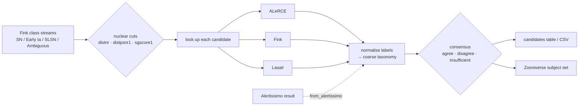

# nucleuswatch

[](https://github.com/bibinthomas123/nucleuswatch/actions/workflows/ci.yml)

[](https://github.com/bibinthomas123/nucleuswatch/blob/main/LICENSE)


**Find nuclear transients in the alert stream, see whether ALeRCE, Fink and
Lasair agree on what they are, and send them to Zooniverse.**


<sub>Real output from 23 Oct 2026. Two of six candidates are flagged
<b>disagree</b>: Pan-STARRS calls the host a galaxy, but Lasair's Sherlock
matches it to a star in SDSS or Gaia. A single-broker filter would let
these through without comment.</sub>

---

## Why

Rubin/LSST alerts reach astronomers only through community brokers, each with
its own API, taxonomy and classifiers. If you care about **what a transient
actually is**, you end up querying each broker by hand and reconciling the
answers yourself.

nucleuswatch does that for one science case, **nuclear transients** (TDEs, AGN
flares, nuclear supernovae):

| | |
|---|---|
| 🔭 **Search** | recent ZTF transients sitting on galaxy nuclei, using the standard positional cuts |
| ⚖️ **Consensus** | every candidate is looked up in ALeRCE, Fink and Lasair, and the result is **agree / disagree / insufficient** |
| 🎯 **TDE score** | candidates are ranked from their light curve and host galaxy; when first picked, the top 10% holds 56% of TDEs, and 75% two months later ([details](https://github.com/bibinthomas123/nucleuswatch/blob/main/validation/TDE_SCORE.md)) |
| ✅ **Validated** | recovers 51% of spectroscopically confirmed TDEs at mag ≤ 19 (72% at ≤ 20) and raises their share 4.9× ([results](https://github.com/bibinthomas123/nucleuswatch/blob/main/validation/RESULTS.md)) |
| 🌌 **ZTF + Rubin** | ZTF names and Rubin/LSST `diaObjectId`s both work, through the same API |
| 📅 **Weekly** | a scheduled job publishes a digest page, an [Atom feed](https://bibinthomas123.github.io/nucleuswatch/feed.xml) and optional Slack/Discord posts, and keeps the history in the repo |
| 🧑‍🔬 **Zooniverse** | one flag writes a subject set ready to upload; broker opinions stay out of the volunteers' view |
| 🔗 **Alertissimo** | works with results from the [Alertissimo](https://github.com/sambolino/alertissimo) orchestration layer |

General multi-broker orchestration is Alertissimo's job. nucleuswatch is
the narrow, science-first layer that sits next to it.

## Documentation

| | |
|---|---|
| 📖 [How it works](https://github.com/bibinthomas123/nucleuswatch/blob/main/docs/how-it-works.md) | The pipeline end to end: adapters, consensus, the nuclear search, new vs known, the TDE score, Rubin, caching |
| 🐍 [Python API](https://github.com/bibinthomas123/nucleuswatch/blob/main/docs/python-api.md) | Every public function and class, with parameters and defaults |
| ⌨️ [Command line](https://github.com/bibinthomas123/nucleuswatch/blob/main/docs/cli.md) | Every command and flag, and the environment variables |
| 📅 [Weekly digest and alerts](https://github.com/bibinthomas123/nucleuswatch/blob/main/docs/weekly-digest.md) | Workflow setup, Slack/Discord alerts, the Atom feed, the data file format |

## Quick start

```bash
git clone https://github.com/bibinthomas123/nucleuswatch.git
cd nucleuswatch
pip install -e ".[plot]"                 # ".[zooniverse]" adds direct upload
cp .env_example .env                     # optional: add your Lasair token
```

```bash
nucleuswatch nuclear --days 7 --mag-max 19            # this week's candidates
nucleuswatch object ZTF21abfmbix --plot lc.png        # one object, all brokers
nucleuswatch object 170587117485817955                # a Rubin/LSST object
nucleuswatch nuclear --days 7 --zooniverse week43/    # + Zooniverse subject set
nucleuswatch digest --days 7                          # weekly record + web page
```

Lasair needs a free token: make an account, copy it from your profile, and
put `LASAIR_TOKEN=...` in `.env` (or export it). Lasair's Rubin server has
separate accounts, so LSST objects need `LASAIR_LSST_TOKEN` as well. Without a
token, Lasair is skipped and the other two brokers still work.

## Screenshots

### One object, three brokers

`nucleuswatch object` shows what each broker reports and which classifiers
vote (`*`). The position offsets between brokers, the TNS name and Lasair's
Sherlock context all appear on one screen.


### The merged light curve

`obj.plot()` overlays every broker's photometry. Marker shape shows the
broker and colour shows the band, and the title records each broker's vote.
Brokers are nudged a few hours apart so points don't hide each other. Here
you can also see that **Fink is missing some alerts** (the first g-band point
and all i-band points) that ALeRCE and Lasair have. `obj.coverage()` lists
exactly which ones.


### What Zooniverse volunteers see

`--zooniverse DIR` writes two images per subject: a **blind** light curve
with no ID, no broker labels and time relative to first detection, and
**New / Before / Difference** stamps of the latest alert.


The manifest uses Zooniverse's column prefixes to control what volunteers can see:

| Manifest column | Visibility | Contents |
|---|---|---|
| `image1`, `image2` | shown | the two images above |
| `!object_id`, `!ra`, `!dec`, `!<broker>_url` | Talk only, after classifying | for discussion and lookup |
| `#consensus`, `#categories`, `#<broker>_<classifier>`, … | never | broker opinions, kept to compare with volunteer votes |

Upload the folder through the Project Builder, with
`panoptes subject-set upload-subjects <set_id> week43/manifest.csv`, or:

```bash
export ZOONIVERSE_USERNAME=... ZOONIVERSE_PASSWORD=...
nucleuswatch zooniverse-upload week43/ --project 1234 --subject-set "Nuclear, week 43"
```

**Bringing the volunteers' answers back.** Download the project's
classification export (*Lab → Data Exports → Request new classification
export*) and tally it:

```bash
nucleuswatch zooniverse-ingest classifications.csv   # majority answer per object
```

Commit the export as `zooniverse/classifications.csv` and the weekly digest
adds the volunteers as one more vote in each candidate's consensus. Each
volunteer counts once per subject. The volunteers vote only when at least 5
of them answered and a majority agree. Answers such as "Not sure" abstain.

## How it works



## Python API

```python
import nucleuswatch as nw

search = nw.nuclear_transients(days=7, cuts=nw.NuclearCuts(mag_max=19, distnr_max=0.5))
search.candidates            # one row per object: mag, distnr, sgscore1, consensus, ...
search.query                 # exact window + cuts used (store it with your results)

obj = search.objects["ZTF26acakche"]       # or nw.get_object("ZTF21abfmbix")
obj.summary()                # per broker: position, offset, ndet, time span, link
obj.classifications          # every classifier output + normalised category
obj.consensus()              # {'status': 'disagree', 'categories': ['SN', 'VarStar'], ...}
obj.coverage()               # which broker has which alert, and magnitude spread
obj.plot()                   # annotated; obj.plot(annotate=False) is the volunteer view

from nucleuswatch.score import tde_score
tde_score(obj)               # 0-1 ranking score; higher = more TDE-like

rubin = nw.lsst_nuclear_transients(days=7, mag_max=20)   # same search on the Rubin stream

from nucleuswatch.zooniverse import export_subjects
export_subjects(search, "week43/")
```

From Alertissimo:

```python
from alertissimo.api import execute_dsl
from nucleuswatch.alertissimo_bridge import from_alertissimo

obj = from_alertissimo(execute_dsl("objects ZTF26acakche from ztf via alerce\nwith lightcurve via fink\n"))
```

## The nuclear cuts

Each alert is tested against these cuts, and the brightest passing alert per object is kept. Every threshold is a parameter.

| Cut | Default | Why |
|---|---|---|
| `magpsf <= mag_max` | 19.0 | bright enough for follow-up |
| `distnr <= distnr_max` | 0.5″ | on the source in the ZTF reference image (the nucleus) |
| `distpsnr1 <= distpsnr1_max` | 1.0″ | a Pan-STARRS1 source is right there |
| `sgscore1 <= sgscore1_max` | 0.5 | and it is galaxy-like (removes variable stars) |
| `ndethist >= ndethist_min` | 2 | not a one-off detection |
| `isdiffpos` | positive | brightening, not fading |

## Validation

How well do the cuts do on objects whose nature is known? The answer comes from
`validation/run_validation.py`, run against every object Fink cross-matched to a
TNS spectroscopic classification in 2024–2025
([full results](https://github.com/bibinthomas123/nucleuswatch/blob/main/validation/RESULTS.md)):

- **24 / 47 confirmed TDEs (51%)** pass the default cuts. The nucleus cuts
  remove only 2; the magnitude limit removes 21. Recovery rises to 64% at
  `mag_max=19.5` and 72% at `mag_max=20`.
- Among all spectroscopically classified objects, the cuts raise the TDE
  share **4.9×** (1.2% → 6.0%). Nuclear SNe Ia and SNe II remain the majority.
  That's expected, and it tells you how much follow-up a nuclear sample costs.
- This measures the cuts, not the selection from Fink's classifier streams.
- **TDE score.** A logistic model ranks candidates from the light curve so
  far and the host galaxy (Legacy Surveys colour, size, redshift). It was
  tested on light curves as they looked when the weekly search first picked
  each object. There, the top 10% of the ranked list holds 56% of TDEs at 32%
  purity, against a 5.8% base rate, and two months later 75% at 42%. Colour
  carries most of the weight; broker labels aren't inputs
  ([details](https://github.com/bibinthomas123/nucleuswatch/blob/main/validation/TDE_SCORE.md)).
- **Live picks.** `validation/prospective.py` checks each week's picks
  against TNS classifications that arrive later, using only what the digest
  recorded at the time. It runs weekly and fills
  [PROSPECTIVE.md](https://github.com/bibinthomas123/nucleuswatch/blob/main/validation/PROSPECTIVE.md).
- **Broker disagreement flags TDEs.** Among 402 classified nuclear objects,
  weighted to the real SN mix, 21% of those where brokers *disagree* are TDEs,
  against 3% where they agree. An ALeRCE TDE vote is right 35% of the time
  (base rate 5.8%)
  ([details](https://github.com/bibinthomas123/nucleuswatch/blob/main/validation/BROKER_TRUTH.md)).

## Rubin/LSST

Pass a Rubin `diaObjectId` anywhere a ZTF name works, for example
`nw.get_object(170587117485817955)`. The survey is detected from the ID.

- ALeRCE (Rubin stamp classifier; its newest model version votes), Fink
  (CATS broad classes, SuperNNova) and Lasair (Sherlock; needs
  `LASAIR_LSST_TOKEN`).
- Rubin difference fluxes can be negative, so light curves keep `flux` and
  `flux_err` in nJy. `mag` is filled only where flux > 0, and plots use flux.
- **Nuclear search:** `nucleuswatch nuclear --survey lsst` (or
  `recipes.lsst_nuclear_transients`) reads Fink's
  `extragalactic_lt20mag_candidate` stream. Rubin alerts carry no host
  information yet, so the nucleus test uses the Legacy Surveys DR10
  catalogue: the nearest source must be a galaxy within 0.5″. In the last
  week of Rubin alerts (July 2026), 12 of 68 bright objects passed. The
  weekly page has a Rubin section.
- As of October 2026 the brokers have received no Rubin alerts since
  14 July 2026; the search reports this rather than an empty list.
- Image stamps are ZTF-only for now.

## Weekly digest

`nucleuswatch digest` runs a wider search than the default recipe and
publishes it. The [weekly workflow](https://github.com/bibinthomas123/nucleuswatch/blob/main/.github/workflows/weekly.yml)
runs it every Monday and deploys the page to GitHub Pages:
**https://bibinthomas123.github.io/nucleuswatch/**

- **Sources:** Fink's SN-like, Ambiguous, TNS- and SIMBAD-labelled AGN/TDE
  streams, plus Lasair objects that Sherlock classes as nuclear transients.
- **Depth:** mag ≤ 20, where validation recovers 72% of confirmed TDEs. Each
  candidate is tagged *bright* (≤ 19) or *faint*.
- **New vs known:** an object is *known* if it was first detected over a
  year ago **and** its nucleus was producing alerts in the two years before
  the current flare (mostly AGN). Everything else, including old sources that
  were quiet for years and have just started flaring, is *new* and compared
  across all brokers. This keeps 75% of confirmed TDEs in the new list (56%
  with a plain age cut). A typical week has ~45 new candidates and ~320
  known sources.
- **Page contents:** headline numbers, a selection funnel, consensus and
  category breakdowns, a sky map, a table and a detailed card per candidate
  (host image from the Legacy Survey, merged light curve, stamps, broker
  votes, TNS name and spectroscopic type), the known-source list, a history
  chart, the method and validation summary, and an archive.
- **Data:** `digest/<date>.json`, `.csv` and `_known.csv` are committed, so
  the history stays in the repo.
- **Alerts:** TDE-like candidates (TDE score ≥ 0.5, a TDE vote from any
  broker, or a TDE type on TNS) go to an
  [Atom feed](https://bibinthomas123.github.io/nucleuswatch/feed.xml) and,
  optionally, to Slack or Discord (below).

### Get the weekly candidates in Slack or Discord

1. **Create an incoming webhook.**
   - *Slack:* <https://api.slack.com/apps> → **Create New App → From
     scratch** → **Incoming Webhooks** → switch it on → **Add New Webhook to
     Workspace** → pick a channel → copy the `https://hooks.slack.com/services/…` URL.
   - *Discord:* channel settings → **Integrations → Webhooks → New Webhook**
     → **Copy Webhook URL**.
2. **Test it locally** (`--always` posts even in a quiet week):
   ```bash
   NUCLEUSWATCH_WEBHOOK='<your URL>' nucleuswatch notify --data digest --always
   ```
3. **Add it to GitHub:** **Settings → Secrets and variables → Actions → New
   repository secret**, name `NUCLEUSWATCH_WEBHOOK`, value the URL.

From then on, each scheduled Monday run posts that week's TDE-like
candidates. Code pushes don't post, and weeks with none post nothing. Keep
the URL secret, since anyone holding it can post to your channel. No webhook?
In Slack, `/feed subscribe https://bibinthomas123.github.io/nucleuswatch/feed.xml`
works too. Full details are in [weekly-digest.md](https://github.com/bibinthomas123/nucleuswatch/blob/main/docs/weekly-digest.md#chat-alerts-slack-or-discord).

Backfill past weeks with `nucleuswatch digest --until 2026-10-16`. Lasair's
query API can't search the past, so backfilled weeks use Fink candidates only.

## How consensus works

<details>
<summary>Details</summary>

**Each broker casts one vote**, from its preferred whole-object classifier
(see `taxonomy.VOTE_PRIORITY`):

- **ALeRCE:** the forced-photometry classifier
  (`lc_classifier_BHRF_forced_phot`), falling back to `lc_classifier` and then
  `stamp_classifier`. The forced-photometry model is the only broker
  classifier with a TDE class; in the validation set its TDE votes are right
  about a third of the time, six times the base rate. The stamp classifier
  only sees the first images.
- **Fink:** `v:classification` (ZTF) or CATS (Rubin).
- **Lasair:** Sherlock.

Labels map to coarse categories (`SN`, `AGN`, `VarStar`, `CV/Nova`, `TDE`, …)
through `nucleuswatch.categorize`. "Unknown" and "Ambiguous" abstain, and so
does Sherlock's `NT` (nuclear transient). `NT` says *where* the source is, and
every candidate here is nuclear by selection, so it says nothing about what
the source is.

- **agree**: every broker's vote lands in one category
- **disagree**: votes land in more than one category
- **insufficient**: fewer than two brokers voted

Every classifier output, including the ones that don't vote, stays in
`obj.classifications`. Binary scores (e.g. Fink's SNIa-vs-non-Ia) get no
category. When a broker serves several versions of one model, the most
confident one is used. The mapping is deliberately simple; please open an
issue if a label is mapped wrongly.
</details>

## Brokers

| Broker | Access | Used for |
|---|---|---|
| [ALeRCE](https://alerce.online) | public | light curve, forced-photometry, light-curve and stamp classifiers |
| [Fink](https://fink-portal.org) | public | candidate streams, light curve, classification, cutouts |
| [Lasair](https://lasair-ztf.lsst.ac.uk) | free token (separate one for [Rubin](https://lasair.lsst.ac.uk)) | light curve, Sherlock context, TNS name |
| [ANTARES](https://antares.noirlab.edu) | public | light curve, filter tags, catalogue crossmatches: an AGN vote when a locus matches the Milliquas or Véron-Cetty quasar/AGN catalogues (right for 29 of 35 in validation) |

A broker that is down, rate-limited or missing a token is reported in
`obj.errors` and doesn't fail the call. Responses are cached on disk (1 h
for objects, 10 min for streams) to respect rate limits.

## Known limitations

- Zooniverse stamps are ZTF-only. The Rubin nuclear search relies on the
  Legacy Surveys DR10 footprint and hasn't been validated against Rubin
  spectroscopic classifications yet.
- The TDE score was fitted on complete light curves of 34 TDEs; it is less
  reliable for objects found a few days ago, and isn't a calibrated
  probability.
- Lasair's Rubin adapter is built against recorded responses and hasn't been
  run live yet (it needs an LSST token).
- Lasair-sourced candidates don't carry ZTF's alert-level cut fields; they
  rely on Sherlock's nuclear association and the magnitude limit.
- The new-vs-known rule's thresholds (30-day flare gaps, 2-year look-back)
  were tuned on the 2024–2025 validation sample and need checking on 2026
  data. 25% of confirmed TDEs still land in the known list.
- Direct Zooniverse upload is tested against a mocked client, not a live project.
- The Alertissimo bridge handles single-object results.
  [docs/alertissimo.md](https://github.com/bibinthomas123/nucleuswatch/blob/main/docs/alertissimo.md) lists what Alertissimo can't do
  yet and the bugs found.

## Development

```bash
python -m venv .venv && source .venv/bin/activate
pip install -e ".[dev]"
pytest                       # offline tests on recorded broker responses
pytest -m live               # also hit the real APIs
python docs/make_images.py   # regenerate the screenshots in this README
python validation/run_validation.py   # rerun the validation (~10 min, cached)
```

Releases: bump `__version__`, then publish a GitHub release tagged
`v<version>`. The [release workflow](https://github.com/bibinthomas123/nucleuswatch/blob/main/.github/workflows/release.yml)
builds the package and uploads it to PyPI.

## Roadmap

- [x] Lasair Sherlock `NT` (nuclear transient) as a second candidate source
- [ ] Fink `latests` recipe upstream in Alertissimo ([notes](https://github.com/bibinthomas123/nucleuswatch/blob/main/docs/alertissimo.md))
- [x] Merge volunteer classifications back into the consensus table
- [x] Weekly digest web page
- [x] Rubin/LSST object IDs
- [x] Validation against spectroscopically classified objects
- [x] Nuclear search on the Rubin stream
- [x] TDE ranking score, Atom feed and chat alerts
- [x] Publish on PyPI
- [x] ANTARES adapter (ZTF)

## Acknowledgements

nucleuswatch only consumes data that the broker teams produce. If you use it in
a paper, please cite the brokers whose results you use
([ALeRCE](https://alerce.online), [Fink](https://fink-broker.org),
[Lasair](https://lasair.lsst.ac.uk)), and
[Alertissimo](https://arxiv.org/abs/2601.10454) if you used the bridge.

## License

[MIT](https://github.com/bibinthomas123/nucleuswatch/blob/main/LICENSE)
