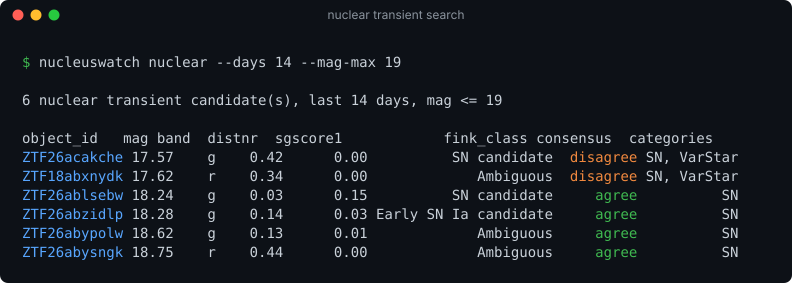
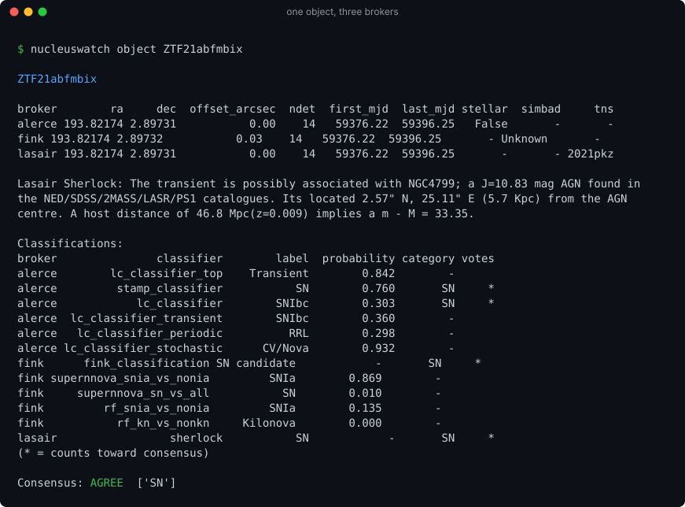
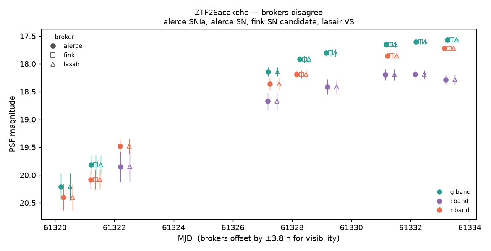
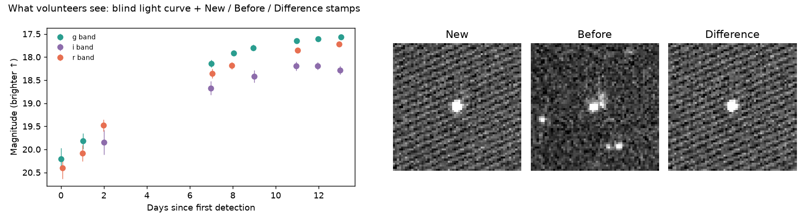
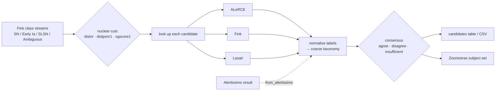

# nucleuswatch

[](https://github.com/bibinthomas123/nucleuswatch/actions/workflows/ci.yml)

[](LICENSE)


**Find nuclear transients in the alert stream, see whether ALeRCE, Fink and
Lasair agree on what they are, and send them to Zooniverse.**



<sub>Real output from 23 Oct 2026. Two of six candidates are flagged
<b>disagree</b>: Pan-STARRS calls the host a galaxy, but Lasair's Sherlock
matches it to a star in SDSS or Gaia. A single-broker filter would let
these through without comment.</sub>

---

## Why

Rubin/LSST alerts reach astronomers only through community brokers, each with
its own API, taxonomy and classifiers. If you care about **what a transient
actually is**, you end up querying each broker by hand and reconciling the
answers yourself.

nucleuswatch does that for one science case, **nuclear transients** (TDEs, AGN
flares, nuclear supernovae):

| | |
|---|---|
| 🔭 **Search** | recent ZTF transients sitting on galaxy nuclei, using the standard positional cuts |
| ⚖️ **Consensus** | every candidate is looked up in ALeRCE, Fink and Lasair, and the result is **agree / disagree / insufficient** |
| 🧑‍🔬 **Zooniverse** | one flag writes a subject set ready to upload; broker opinions stay out of the volunteers' view |
| 🔗 **Alertissimo** | works with results from the [Alertissimo](https://github.com/sambolino/alertissimo) orchestration layer |

General multi-broker orchestration is Alertissimo's job. nucleuswatch is
the narrow, science-first layer that sits next to it.

## Quick start

```bash
git clone https://github.com/bibinthomas123/nucleuswatch.git
cd nucleuswatch
pip install -e ".[plot]"                 # ".[zooniverse]" adds direct upload
cp .env_example .env                     # optional: add your Lasair token
```

```bash
nucleuswatch nuclear --days 7 --mag-max 19            # this week's candidates
nucleuswatch object ZTF21abfmbix --plot lc.png        # one object, all brokers
nucleuswatch nuclear --days 7 --zooniverse week43/    # + Zooniverse subject set
```

Lasair needs a free token: make an account, copy it from your profile, and
put `LASAIR_TOKEN=...` in `.env` (or export it). Without one, Lasair is
skipped and the other two brokers still work.

## Screenshots

### One object, three brokers

`nucleuswatch object` shows what each broker reports and which classifiers
vote (`*`). The position offsets between brokers, the TNS name and Lasair's
Sherlock context all appear on one screen.



### The merged light curve

`obj.plot()` overlays every broker's photometry. Marker shape shows the
broker and colour shows the band, and the title records each broker's vote.
Brokers are nudged a few hours apart so points don't hide each other. Here
you can also see that **Fink is missing some alerts** (the first g-band point
and all i-band points) that ALeRCE and Lasair have. `obj.coverage()` lists
exactly which ones.



### What Zooniverse volunteers see

`--zooniverse DIR` writes two images per subject: a **blind** light curve
with no ID, no broker labels and time relative to first detection, and
**New / Before / Difference** stamps of the latest alert.



The manifest uses Zooniverse's column prefixes to control what volunteers can see:

| Manifest column | Visibility | Contents |
|---|---|---|
| `image1`, `image2` | shown | the two images above |
| `!object_id`, `!ra`, `!dec`, `!<broker>_url` | Talk only, after classifying | for discussion and lookup |
| `#consensus`, `#categories`, `#<broker>_<classifier>`, … | never | broker opinions, kept to compare with volunteer votes |

Upload the folder through the Project Builder, with
`panoptes subject-set upload-subjects <set_id> week43/manifest.csv`, or:

```bash
export ZOONIVERSE_USERNAME=... ZOONIVERSE_PASSWORD=...
nucleuswatch zooniverse-upload week43/ --project 1234 --subject-set "Nuclear, week 43"
```

## How it works



## Python API

```python
import nucleuswatch as nw

search = nw.nuclear_transients(days=7, cuts=nw.NuclearCuts(mag_max=19, distnr_max=0.5))
search.candidates            # one row per object: mag, distnr, sgscore1, consensus, ...
search.query                 # exact window + cuts used (store it with your results)

obj = search.objects["ZTF26acakche"]       # or nw.get_object("ZTF21abfmbix")
obj.summary()                # per broker: position, offset, ndet, time span, link
obj.classifications          # every classifier output + normalised category
obj.consensus()              # {'status': 'disagree', 'categories': ['SN', 'VarStar'], ...}
obj.coverage()               # which broker has which alert, and magnitude spread
obj.plot()                   # annotated; obj.plot(annotate=False) is the volunteer view

from nucleuswatch.zooniverse import export_subjects
export_subjects(search, "week43/")
```

From Alertissimo:

```python
from alertissimo.api import execute_dsl
from nucleuswatch.alertissimo_bridge import from_alertissimo

obj = from_alertissimo(execute_dsl("objects ZTF26acakche from ztf via alerce\nwith lightcurve via fink\n"))
```

## The nuclear cuts

Each alert is tested against these cuts, and the brightest passing alert per object is kept. Every threshold is a parameter.

| Cut | Default | Why |
|---|---|---|
| `magpsf <= mag_max` | 19.0 | bright enough for follow-up |
| `distnr <= distnr_max` | 0.5″ | on the source in the ZTF reference image (the nucleus) |
| `distpsnr1 <= distpsnr1_max` | 1.0″ | a Pan-STARRS1 source is right there |
| `sgscore1 <= sgscore1_max` | 0.5 | and it is galaxy-like (removes variable stars) |
| `ndethist >= ndethist_min` | 2 | not a one-off detection |
| `isdiffpos` | positive | brightening, not fading |

## How consensus works

<details>
<summary>Details</summary>

Only classifiers that give a whole-object best guess vote (see
`taxonomy.VOTING_CLASSIFIERS`): ALeRCE `stamp_classifier` and
`lc_classifier`, Fink `v:classification`, and Lasair Sherlock. Labels map to
coarse categories (`SN`, `AGN`, `VarStar`, `CV/Nova`, `TDE`, `Nuclear`, …)
through `nucleuswatch.categorize`. "Unknown" and "Ambiguous" abstain.

- **agree**: every vote lands in one category
- **disagree**: votes land in more than one category
- **insufficient**: fewer than two brokers voted

Binary scores (e.g. Fink's SNIa-vs-non-Ia) are shown but get no category and
no vote. When ALeRCE serves several versions of one model, it still gets one
vote. The mapping is deliberately simple; please open an issue if a label is
mapped wrongly.
</details>

## Brokers

| Broker | Access | Used for |
|---|---|---|
| [ALeRCE](https://alerce.online) | public | light curve, `stamp_classifier`, `lc_classifier` |
| [Fink](https://fink-portal.org) | public | candidate streams, light curve, classification, cutouts |
| [Lasair](https://lasair-ztf.lsst.ac.uk) | free token | light curve, Sherlock context, TNS name |

A broker that is down, rate-limited or missing a token is reported in
`obj.errors` and doesn't fail the call. Responses are cached on disk (1 h
for objects, 10 min for streams) to respect rate limits.

## Known limitations

- ZTF only for now; LSST IDs will follow as broker LSST APIs stabilise.
- Candidates come only from four Fink classes, so objects Fink files
  elsewhere (e.g. SIMBAD-matched AGN) are not searched yet.
- Direct Zooniverse upload is tested against a mocked client, not a live project.
- The Alertissimo bridge handles single-object results.
  [docs/alertissimo.md](docs/alertissimo.md) lists what Alertissimo can't do
  yet and the bugs found.

## Development

```bash
python -m venv .venv && source .venv/bin/activate
pip install -e ".[dev]"
pytest                       # offline tests on recorded broker responses
pytest -m live               # also hit the real APIs
python docs/make_images.py   # regenerate the screenshots in this README
```

## Roadmap

- [ ] Lasair Sherlock `NT` (nuclear transient) as a second candidate source
- [ ] Fink `latests` recipe upstream in Alertissimo ([notes](docs/alertissimo.md))
- [ ] Merge volunteer classifications back into the consensus table
- [ ] Minimal web page for browsing a saved search
- [ ] LSST object IDs; ANTARES adapter

## Acknowledgements

nucleuswatch only consumes data that the broker teams produce. If you use it in
a paper, please cite the brokers whose results you use
([ALeRCE](https://alerce.online), [Fink](https://fink-broker.org),
[Lasair](https://lasair.lsst.ac.uk)), and
[Alertissimo](https://arxiv.org/abs/2601.10454) if you used the bridge.

## License

[MIT](LICENSE)
