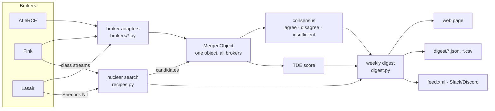

# How it works

[← Documentation](README.md)

The package has four layers. Each one only uses the layer below it.

1. **Broker adapters** (`nucleuswatch/brokers/`) talk to one broker each and
   turn its answer into the same shape.
2. **Merged objects** (`core.py`) put the brokers' answers about one object
   side by side and decide whether they agree.
3. **Recipes** (`recipes.py`) search the alert streams for nuclear
   transients and merge each candidate.
4. **The digest** (`digest.py`, `notify.py`) turns a weekly search into a
   web page, data files, a feed and chat messages.

## 1. Broker adapters

There is one module per broker and survey:

| Survey | ALeRCE | Fink | Lasair |
|---|---|---|---|
| ZTF | `brokers/alerce.py` | `brokers/fink.py` | `brokers/lasair.py` (token) |
| Rubin/LSST | `brokers/alerce_lsst.py` | `brokers/fink_lsst.py` | `brokers/lasair_lsst.py` (LSST token) |

Every adapter has `fetch(object_id)` → `BrokerResult` and a pure
`parse(...)` that builds the result from raw API responses. The tests feed
`parse` recorded responses, so they run offline. A `BrokerResult` holds:

- `lightcurve`: a DataFrame with columns `mjd, band, mag, mag_err, flux,
  flux_err, candid, broker`. ZTF rows have magnitudes. Rubin rows have
  difference fluxes in nJy, and `mag` is filled only where the flux is
  positive (`mag = -2.5 log10(flux) + 31.4`).
- `classifications`: columns `broker, classifier, label, probability,
  version`, one row per classifier output.
- `ra`, `dec`, `url` (the broker's web page for the object) and `extra`, a
  dict of broker-specific facts such as the Sherlock description, the TNS
  name and type, or the SIMBAD crossmatch.

All HTTP goes through `_http.request_json`. It retries on 502/503/504, turns
401/404/429 into a readable `BrokerError`, and keeps a disk cache (see
[Caching and rate limits](#caching-and-rate-limits)).

## 2. Merged objects and consensus

`get_object(object_id)` works out the survey from the ID (`ZTF…` names are
ZTF, integer `diaObjectId`s are Rubin). It calls every broker in parallel and
returns a `MergedObject`. A broker that fails (it's down, rate-limited, or
has no token) goes into `.errors` instead of failing the call.

**Consensus** compares one vote per broker:

| Broker | Classifier that votes, in order of preference |
|---|---|
| ALeRCE | forced-photometry light-curve classifier (`lc_classifier_BHRF_forced_phot`) → alert light-curve classifier (`lc_classifier`) → stamp classifier |
| Fink | `v:classification` (ZTF) or CATS broad classes (Rubin) |
| Lasair | Sherlock |

The first classifier in the list that answered casts the broker's vote. When
a classifier appears in several model versions, the most confident row
wins. Binary scores, such as Fink's SN Ia vs non-Ia score, never vote.

Labels are mapped onto coarse categories (`SN`, `TDE`, `AGN`, `VarStar`,
`CV/Nova`, `Star`, `Bogus`, …) by `taxonomy.categorize`. These labels
abstain, meaning they cast no vote:

- "Unknown", "Ambiguous" and similar labels;
- Fink's CATS "Fast" and "Long" classes, which mix several physical types;
- Sherlock's `NT` ("nuclear transient"). It says *where* a source is, and every
  candidate here is nuclear by construction.

The result is `agree` (every vote lands in one category), `disagree` (votes
land in more than one), or `insufficient` (fewer than two votes).

Why ALeRCE's forced-photometry classifier comes first: it is the only
broker classifier with a TDE class. With it voting, 21% of the objects the
brokers disagree on are TDEs, against 3% of those they agree on
([BROKER_TRUTH.md](../validation/BROKER_TRUTH.md)).

## 3. The nuclear search (ZTF)

`recipes.nuclear_transients` builds the candidate list in five steps.

1. **Collect alerts** from Fink's class streams over the window: SN
   candidate, Early SN Ia candidate, SLSN candidate, Ambiguous, and the
   TNS- and SIMBAD-labelled TDE/AGN/QSO streams. Fink's `latests` endpoint
   returns at most 1000 alerts per call, so busy windows are split in half
   until every alert is retrieved. Optionally, Lasair objects that Sherlock
   classes as `NT` within 1″ of the host core are added.
2. **Apply the nuclear cuts** (`NuclearCuts`) to every alert:

   | Cut | Default | Meaning |
   |---|---|---|
   | `magpsf ≤ mag_max` | 19 (20 in the digest) | bright enough to follow up |
   | `distnr ≤ distnr_max` | 0.5″ | on top of a source in the ZTF reference image |
   | `distpsnr1 ≤ distpsnr1_max` | 1.0″ | a Pan-STARRS1 source is close |
   | `0 ≤ sgscore1 ≤ sgscore1_max` | 0.5 | …and it looks like a galaxy, not a star |
   | `ndethist ≥ ndethist_min` | 2 | not a single detection |
   | `isdiffpos` positive | | brightening, not fading below the reference |

   Each object keeps its brightest passing alert.
3. **Split new from known** (when `new_within_days` is set; the digest uses
   365 days):
   - An object first detected less than `new_within_days` ago is **new**.
   - An older object is **known** only if its nucleus was already active
     before the current flare. The flare is the run of positive alerts with
     no gap longer than `flare_gap` (30 d). "Already active" means a positive
     alert in the `flare_lookback` days (730) before the flare began, or a
     flare that itself started more than `new_within_days` ago.
   - The alert history comes from ALeRCE, which keeps every public ZTF alert.
     Fink is the fallback. If neither answers, the object is filed as known
     and a note is added to `errors`.

   An AGN that varies all the time stays known. A galaxy that was quiet for
   years and has just flared, which is what a TDE looks like, comes back as
   new. On 2024–2025 data, this keeps 75% of confirmed TDEs in the new list,
   against 56% with a plain age cut.
4. **Merge** each new candidate across brokers (`merge_objects`). ALeRCE and
   Fink are queried per object, in parallel. Lasair is queried in **one
   batch** of two queries, because its API allows only 100 calls per hour.
5. **Record** everything needed to reproduce the run in `search.query`
   (window, cuts, the sources actually used) and in `search.funnel` (how
   many alerts and objects survived each step).

## 4. The TDE score

`score.tde_score(obj)` returns a number from 0 to 1 from a logistic model
over twelve features, all known when the weekly search picks an object:

| Feature | From |
|---|---|
| `g_r` | median g − r colour of the transient (g and r detections within 1 day) |
| `g_r_slope` | change of g − r per 100 days |
| `log_rise` | log10(1 + days from first detection to peak) |
| `fade_rate` | mag/day after the peak (missing until the peak has passed) |
| `amplitude` | brightest to faintest detection, in mag |
| `log_ndet` | log10(number of detections) |
| `peak_abs_mag` | peak magnitude minus the host's distance modulus |
| `host_g_r` | host galaxy g − r, corrected for Milky Way dust |
| `host_abs_r` | host r-band absolute magnitude |
| `host_log_size` | log10 of the host's half-light radius |
| `host_point` | the host is a point source (quasar-like) |
| `simbad_agn` | Fink's alert-time SIMBAD crossmatch is an AGN/QSO |

Host properties come from the Legacy Surveys DR9 catalogue (`hosts.py`). The
redshift is spectroscopic where the catalogue has one, photometric otherwise,
and converted to a distance with flat ΛCDM (H0 = 70, Ωm = 0.3). Missing values
are filled with the training medians, so an object outside the survey
footprint is scored from its light curve alone.

**Training on light curves as they were.** `validation/tde_score.py` fits
the weights on 402 spectroscopically classified nuclear objects. Each object's
light curve is cut off at *selection*, meaning its first alert passing the
nuclear cuts, when the weekly search would first have listed it. It is also
evaluated 7, 14, 28 and 56 days later, and in full. All snapshots of one object
stay in the same cross-validation fold.

| Light curve used | TDEs in the top 10% | TDE share of the top 10% |
|---|---|---|
| at selection | 56% | 32% |
| +2 weeks | 68% | 38% |
| +8 weeks | 75% | 42% |

The base rate is 5.8%. Colour carries most of the weight: TDEs stay hot and
blue, while supernovae redden as they cool. Host features matter most early
(AUC 0.90 with them at selection, 0.85 without).

**Why broker labels aren't inputs.** The training set only has today's broker
classifications, not what the brokers said when each object was picked.
Adding them anyway barely helps (AUC 0.94 against 0.93 on full light curves),
and would make the early-time numbers look better than they are. ALeRCE's
TDE vote is still shown next to the score, and still triggers an alert.

The weights are in `nucleuswatch/assets/tde_score.json`. Treat the score as
a ranking, not a probability.

## 5. Rubin/LSST

Any function that takes an object ID also takes a Rubin `diaObjectId`. The
search is `recipes.lsst_nuclear_transients`:

1. Alerts come from Fink's `extragalactic_lt20mag_candidate` tag (rising,
   mag < 20, extragalactic). Each object keeps its brightest alert with
   positive flux, provided it is brighter than `mag_max`.
2. Rubin alerts don't yet carry host information, so `hosts.py` looks up
   the nearest source within 2″ in the **Legacy Surveys DR10** Tractor
   catalogue, through NOIRLab's Astro Data Lab TAP service. That catalogue
   comes from DECam imaging, which covers most of the Rubin sky. The
   transient is nuclear when the nearest source is a galaxy model (REX, EXP,
   DEV or SER, not PSF) within `max_offset` (0.5″).
3. Candidates are merged with ALeRCE (Rubin stamp classifier) and Fink (CATS
   classes).

If the window has no alerts at all, `search.query["latest_alert_mjd"]` says
when the stream last had one. The brokers have received no Rubin alerts since
14 July 2026, and the weekly page reports that instead of an empty table.

## Caching and rate limits

- Responses are cached on disk in `~/.cache/nucleuswatch`, or
  `$NUCLEUSWATCH_CACHE` if set. The cache key is the method, URL, parameters
  and body, never the auth headers, so tokens are never written to disk.
- How long a response is reused (TTL):

  | Response | Reused for |
  |---|---|
  | Object lookups | 1 hour |
  | Stream queries for a live window | 10 minutes |
  | Stream queries for a window that ended more than 2 days ago | 30 days (it can't change any more) |
  | Alert histories | 1 day |
  | Host-catalogue matches | 30 days |

- Pass `use_cache=False` (or `--no-cache` on the command line) to refetch.
- **Lasair** allows 100 calls per hour per token, over a rolling hour. A
  weekly digest uses about three: one for the nuclear-transient query and
  two for the batched classifications of every candidate.

## Zooniverse and Alertissimo

- `zooniverse.export_subjects` writes a subject set. Each subject has a blind
  light curve (no IDs, no broker labels) and Fink's science, template and
  difference stamps, plus `manifest.csv`. Columns starting with `#` are
  hidden from volunteers. Columns starting with `!` appear only in Talk. Broker
  opinions are hidden, so volunteers' votes stay independent.
- `alertissimo_bridge.from_alertissimo` turns an Alertissimo
  `DSLExecutionResult` into a `MergedObject`, so consensus, plots and export
  work on Alertissimo results too.
