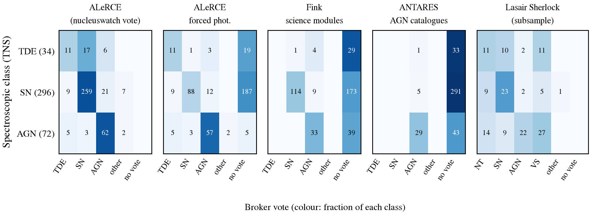
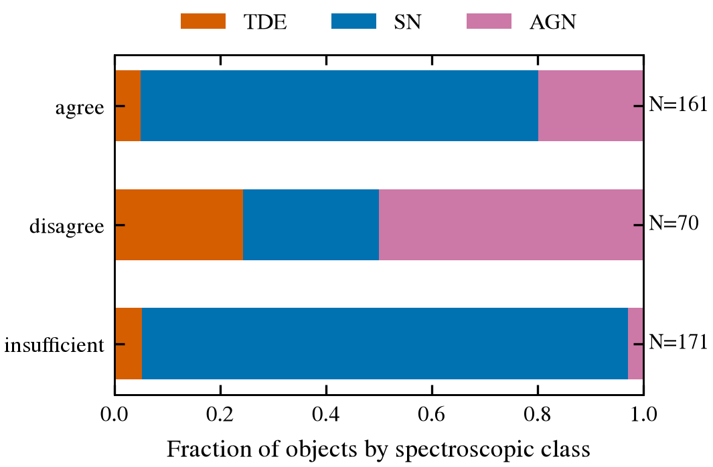

# Broker classifications vs spectroscopic truth

Sample: 402 TNS-classified objects passing the nuclear cuts at mag ≤ 20, 2024-01-01 → 2026-01-01
(TDE: 34, SN Ia: 150, SN II: 85, SN IIn: 26, SN Ibc: 25, SLSN: 10, AGN/QSO: 72). SN Ia randomly subsampled from 339
(seed 20261024). nucleuswatch 1.1.0, generated 2026-10-24T18:57:24+00:00 by `validation/broker_truth.py`.

## ALeRCE, the vote nucleuswatch casts (forced-photometry classifier, else light curve, else stamp)

| truth \ vote | TDE | SN | AGN | other | no vote | correct |
|---|---|---|---|---|---|---|
| TDE (34) | 11 | 17 | 6 | 0 | 0 | 11/34 of those voting |
| SN (296) | 9 | 259 | 21 | 7 | 0 | 259/296 of those voting |
| AGN (72) | 5 | 3 | 62 | 2 | 0 | 62/72 of those voting |

## ALeRCE forced-photometry classifier (`lc_classifier_BHRF_forced_phot`, has a TDE class)

| truth \ vote | TDE | SN | AGN | other | no vote | correct |
|---|---|---|---|---|---|---|
| TDE (34) | 11 | 1 | 3 | 0 | 19 | 11/15 of those voting |
| SN (296) | 9 | 88 | 12 | 0 | 187 | 88/109 of those voting |
| AGN (72) | 5 | 3 | 57 | 2 | 5 | 57/67 of those voting |

## Fink, alert-time science modules only (SIMBAD crossmatch + SuperNNova)

| truth \ vote | TDE | SN | AGN | other | no vote | correct |
|---|---|---|---|---|---|---|
| TDE (34) | 0 | 1 | 4 | 0 | 29 | 0/5 of those voting |
| SN (296) | 0 | 114 | 9 | 0 | 173 | 114/123 of those voting |
| AGN (72) | 0 | 0 | 33 | 0 | 39 | 33/33 of those voting |

## Fink, served classification (includes the TNS answer; leakage)

| truth \ vote | TDE | SN | AGN | other | no vote | correct |
|---|---|---|---|---|---|---|
| TDE (34) | 0 | 7 | 4 | 0 | 23 | 0/11 of those voting |
| SN (296) | 0 | 121 | 9 | 3 | 163 | 121/133 of those voting |
| AGN (72) | 0 | 0 | 33 | 0 | 39 | 33/33 of those voting |

## ANTARES, AGN/quasar catalogue match (Milliquas, Véron-Cetty)

| truth \ vote | TDE | SN | AGN | other | no vote | correct |
|---|---|---|---|---|---|---|
| TDE (34) | 0 | 0 | 1 | 0 | 33 | 0/1 of those voting |
| SN (296) | 0 | 0 | 5 | 0 | 291 | 0/5 of those voting |
| AGN (72) | 0 | 0 | 29 | 0 | 43 | 29/29 of those voting |

## Lasair Sherlock (raw labels, N = 146)

| truth \ vote | NT | SN | AGN | VS | other | no vote | correct |
|---|---|---|---|---|---|---|---|
| TDE (34) | 11 | 10 | 2 | 11 | 0 | 0 | 0/34 of those voting |
| SN (40) | 9 | 23 | 2 | 5 | 1 | 0 | 23/40 of those voting |
| AGN (72) | 14 | 9 | 22 | 27 | 0 | 0 | 22/72 of those voting |

## Consensus status vs truth (ALeRCE + Fink science modules + ANTARES + Lasair)

| status | objects | TDE | SN | AGN | P(TDE \| status), 68% interval |
|---|---|---|---|---|---|
| agree | 161 | 8 | 121 | 32 | 5% (4–7%) |
| disagree | 70 | 17 | 18 | 35 | 24% (20–30%) |
| insufficient | 171 | 9 | 157 | 5 | 5% (4–7%) |

Cohen's κ, ALeRCE vs Fink (science modules), where both voted: **0.74**

### Weighted to the full nuclear stream

The sample keeps fewer SNe than the stream contains. Weighting each object by
(group size before subsampling) / (group size in the sample):

| status | P(TDE \| status) |
|---|---|
| disagree | 20.9% |
| insufficient | 3.6% |
| agree | 3.1% |

An ALeRCE TDE vote is right 35% of the time (11 of 31.3 weighted objects), against a TDE base rate of 5.8%.

Caveats: ALeRCE classifications are today's, computed on the full light curve, not at selection
time. Fink's ZTF science modules can't produce a TDE label, so a Fink TDE vote is impossible
by construction. Sherlock labels describe host association (SN = offset from a galaxy, NT = on
the nucleus), not physical type.
