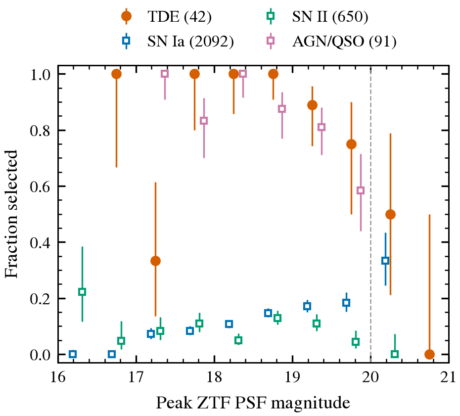
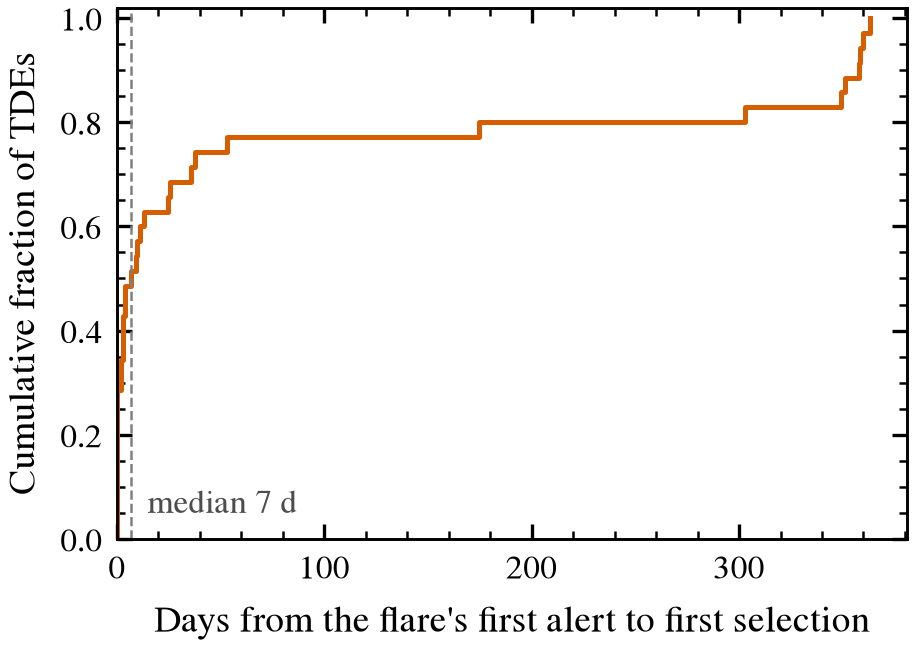

# End-to-end completeness

The weekly recipe (Fink sources, cuts at `mag_max` ≤ 20.5) is replayed from **2024-01-01 to 2026-01-01** (104 weekly windows). Truth is the TNS
spectroscopic classification as cross-matched by Fink. nucleuswatch 1.0.0, generated 2026-10-24T04:16:53+00:00 by `validation/end_to_end.py`.

## Confirmed TDEs

- Pass the alert-level cuts (mag ≤ 20.5) in at least one alert: **37 / 47**
- Selected by the full weekly recipe at mag ≤ 20: **36 / 47 (77%)**
- At the same limit (mag ≤ 20.5), TDEs with a passing alert that the recipe never selected (stream-selection loss): 0. Selected although no TNS-stream alert passes (the recipe saw a passing alert in another stream): 1. The TNS stream holds only part of each object's alerts, so the two counts use different alert sets.
- Median latency from the flare's first alert to first selection: **7 d** (16th–84th percentile 0–329 d, N = 35). Flare onset is the earliest alert within a year before selection. Objects with alerts throughout that year (ongoing nuclear activity) have no well-defined onset and pile up near 365 d.
- Selected TDEs that the digest would file as *known* (Fink's first detection > 365 d before selection): **16**. Their positions have older detections (nuclear variability or subtraction residuals), so a first-detection age test misfiles them; the long tail of the latency distribution has the same cause.

## Selection by type

| TNS type | objects | pass alert cuts | selected ≤ 19.0 | selected ≤ 19.5 | selected ≤ 20.0 | selected ≤ 20.5 |
|---|---|---|---|---|---|---|
| SN Ia | 2505 | 349 | 183 (7%) | 226 (9%) | 243 (10%) | 245 (10%) |
| SN II | 808 | 88 | 46 (6%) | 54 (7%) | 59 (7%) | 61 (8%) |
| SN Ibc | 180 | 26 | 13 (7%) | 16 (9%) | 18 (10%) | 19 (11%) |
| SN IIn | 123 | 29 | 11 (9%) | 12 (10%) | 14 (11%) | 14 (11%) |
| AGN/QSO | 117 | 74 | 48 (41%) | 64 (55%) | 72 (62%) | 74 (63%) |
| SLSN | 75 | 11 | 4 (5%) | 5 (7%) | 5 (7%) | 5 (7%) |
| TDE | 47 | 37 | 24 (51%) | 32 (68%) | 36 (77%) | 38 (81%) |

Error bars are 68% Wilson intervals.
