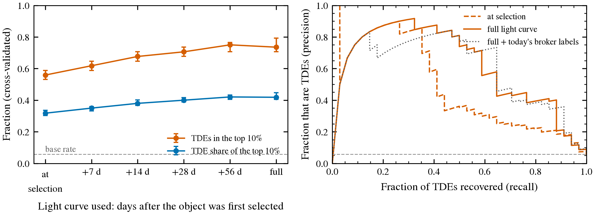

# TDE ranking score

402 TNS-classified nuclear objects (34 TDEs), 2024-01-01 → 2026-01-01, weighted to the full nuclear stream (TDE base rate 5.8%); 288 have a Legacy Surveys host, 254 of them with a redshift. nucleuswatch 1.1.0, generated 2026-10-24T18:46:56+00:00 by `validation/tde_score.py`.

Each object is scored from its light curve as it stood at *selection* (its first alert passing the nuclear
cuts, when the weekly search would first list it) and at later dates. Cross-validation: 5-fold, stratified, repeated 20 times, with all of an object's snapshots in one fold (median and 16–84th percentiles).

| light curve used | ROC AUC | TDEs in the top 10% | TDE share of the top 10% |
|---|---|---|---|
| at selection | 0.90 | 56% (53–59%) | 32% (30–34%) |
| +7 d | 0.91 | 62% (59–65%) | 35% (33–36%) |
| +14 d | 0.93 | 68% (65–71%) | 38% (37–40%) |
| +28 d | 0.94 | 71% (68–74%) | 40% (39–42%) |
| +56 d | 0.95 | 75% (71–76%) | 42% (40–43%) |
| full | 0.93 | 74% (71–79%) | 42% (40–45%) |

For comparison, on full light curves only:

| model | ROC AUC | TDEs in the top 10% | TDE share of the top 10% |
|---|---|---|---|
| shipped (light curve + host) | 0.93 | 74% (71–79%) | 42% (40–45%) |
| + today's broker labels (not shipped) | 0.94 | 74% (68–74%) | 42% (39–42%) |
| light curve only, no host | 0.92 | 76% (74–79%) | 44% (42–46%) |

Broker labels are left out of the shipped model because only today's are known; what the brokers said
when each object was picked isn't recorded. They add little once the light curve is in.

Host features matter most early, while the light curve is short:

| light curve used | ROC AUC with host | without host |
|---|---|---|
| at selection | 0.90 | 0.85 |
| +7 d | 0.91 | 0.88 |
| +14 d | 0.93 | 0.90 |
| +28 d | 0.94 | 0.92 |
| +56 d | 0.95 | 0.93 |
| full | 0.93 | 0.92 |

Standardised coefficients of the shipped model (positive = more TDE-like):

| feature | coefficient |
|---|---|
| `g_r` | -1.88 |
| `host_g_r` | +1.12 |
| `amplitude` | +1.00 |
| `g_r_slope` | -0.93 |
| `fade_rate` | -0.91 |
| `log_rise` | -0.58 |
| `host_point` | -0.45 |
| `peak_abs_mag` | +0.43 |
| `host_log_size` | -0.15 |
| `simbad_agn` | -0.15 |
| `log_ndet` | +0.03 |
| `host_abs_r` | -0.02 |

Caveats: 34 TDEs is a small training set, so the model is small and strongly regularised
(L2 = 1.0). Host redshifts are mostly photometric, which blurs the absolute magnitudes. The score
ranks; it isn't a calibrated probability. `validation/prospective.py` measures the live picks.
